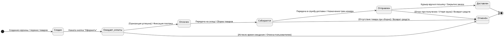

# «Онлайн-покупка»
**Выполнил:** Лукьянов Данил Денисович
**Группа:** СИ-141  
**Вариант / Тема:** «Онлайн-покупка»  

---

## 1. Диаграмма последовательности «Оформление заказа и оплата»

### Описание сценария:
Диаграмма моделирует основной процесс (Happy Path), при котором Покупатель инициирует оформление заказа из Корзины. Корзина взаимодействует со Складом для валидации остатков товара, после чего обращается к Системе оплаты для проведения транзакции. Архитектура учитывает безопасность: товар резервируется на складе ДО списания средств. Ветвления (alt/else) обрабатывают сценарии отсутствия товара и ошибки платежа, автоматически снимая резерв при неудаче.

### Исходный код PlantUML (`zadanie.puml`):

---

## 2. Диаграмма состояний объекта «Заказ»

### Обоснование выбранных состояний:
Жизненный цикл заказа отражает классическую логику E-commerce:
* **Создан** и **Ожидает оплаты** разделяют намерение пользователя и факт фиксации платежа.
* **Собирается** и **Отправлен** необходимы для интеграции с WMS (складом) и логистическими службами.
* Переход в терминальное состояние **Отменён** предусмотрен почти на каждом этапе (неуспешный платеж, брак при сборке на складе, отказ клиента при получении у курьера).

### Исходный код PlantUML (`zadanie2.puml`):

